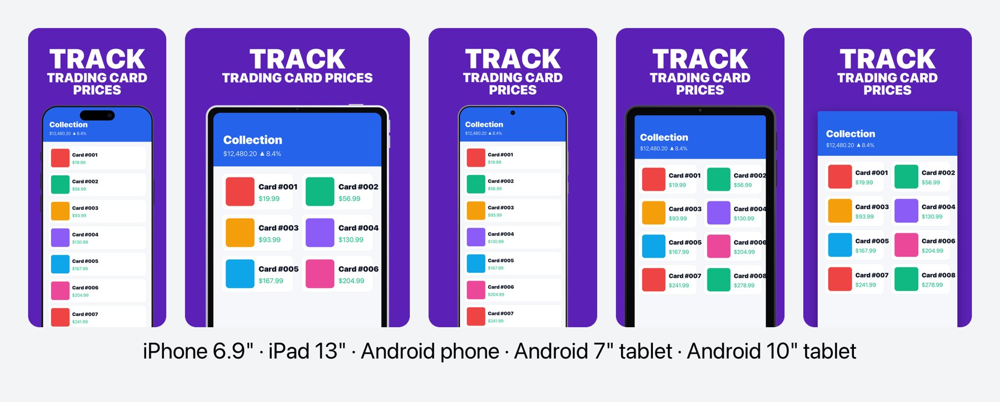
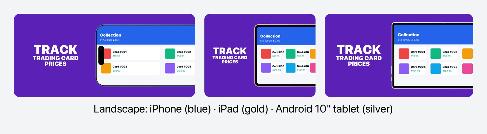
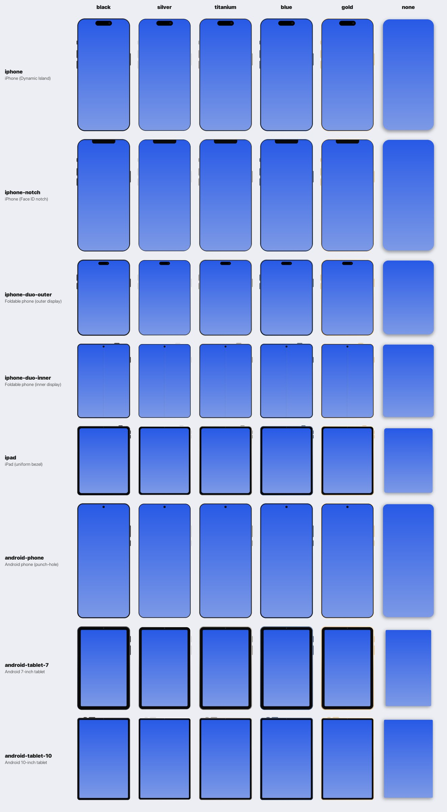
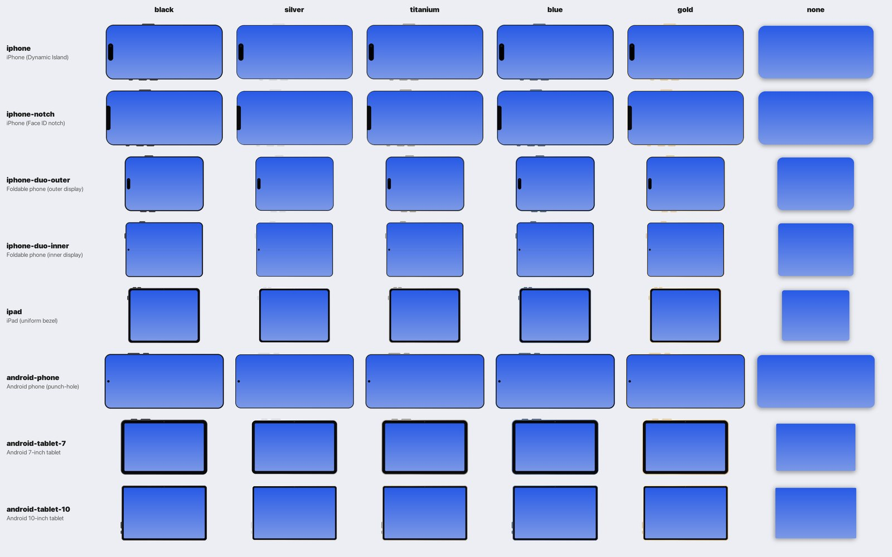
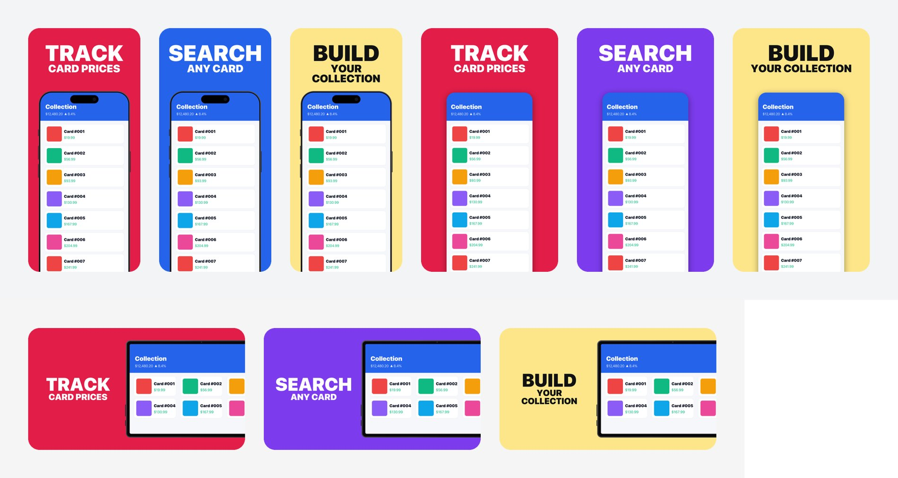

# ASO Store Screenshots — Agent Skill for Claude Code & GitHub Copilot

Generate **high-converting App Store and Google Play screenshots** straight from your app's codebase.
The skill analyses your project, finds the 3–5 benefits that actually drive downloads, rates and pairs your
simulator/emulator captures, and renders **pixel-exact store images** with programmatic device frames for
**iPhone, iPad, Android phones, Android 7" tablets and Android 10" tablets** — in portrait or landscape, with
six frame skins and **any custom background colour** (one for the whole set, per device or per screenshot). An optional AI pass (Nano Banana Pro via the Gemini MCP server) adds photorealistic devices,
"breakout" UI panels and agency-level polish.

It runs as an [Agent Skill](https://agentskills.io) — the same folder works in **Claude Code**,
**GitHub Copilot CLI**, **VS Code (Copilot agent mode)**, the **Copilot cloud agent** and any other agent that
supports the open `SKILL.md` standard.




---

## Contents

1. [What the skill does](#1-what-the-skill-does)
2. [Key features](#2-key-features)
3. [Supported devices and exact sizes](#3-supported-devices-and-exact-sizes)
4. [Device frames, skins and background colours](#4-device-frames-skins-and-background-colours)
5. [Requirements](#5-requirements)
6. [Installation](#6-installation)
   - [6.1 One-command install (macOS / Linux)](#61-one-command-install-macos--linux)
   - [6.2 One-command install (Windows)](#62-one-command-install-windows)
   - [6.3 Claude Code](#63-claude-code)
   - [6.4 GitHub Copilot CLI](#64-github-copilot-cli)
   - [6.5 VS Code — GitHub Copilot agent mode](#65-vs-code--github-copilot-agent-mode)
   - [6.6 Copilot cloud agent (GitHub.com)](#66-copilot-cloud-agent-githubcom)
   - [6.7 Other Agent Skills–compatible agents](#67-other-agent-skillscompatible-agents)
   - [6.8 Manual installation](#68-manual-installation)
   - [6.9 What the installer changes on your machine](#69-what-the-installer-changes-on-your-machine)
   - [6.10 Updating and uninstalling](#610-updating-and-uninstalling)
7. [Gemini MCP setup (optional AI enhancement)](#7-gemini-mcp-setup-optional-ai-enhancement)
8. [Using the skill](#8-using-the-skill)
9. [Capturing great raw screenshots](#9-capturing-great-raw-screenshots)
10. [Script reference](#10-script-reference)
11. [Output folders and where to upload them](#11-output-folders-and-where-to-upload-them)
12. [Store rules cheat sheet](#12-store-rules-cheat-sheet)
13. [Troubleshooting](#13-troubleshooting)
14. [Repository layout](#14-repository-layout)
15. [License and acknowledgements](#15-license-and-acknowledgements)

---

## 1. What the skill does

The agent walks you through six phases. Progress is saved to `screenshots/aso-state.json` in your project after
every decision, so you can stop at any time and resume later — even from a different agent.

| Phase | What happens | Your input |
|-------|--------------|------------|
| **Recall** | Reads saved progress and shows a status summary | Resume, jump to a phase, or change one thing |
| **1. Benefit discovery** | Reads your code (SwiftUI/UIKit, Compose/XML, Flutter, React Native, IAP, onboarding, metadata) and drafts 3–5 benefit headlines, each starting with an action verb ("TRACK TRADING CARD PRICES") | Answer a few questions, approve or edit the headlines |
| **2. Platforms & devices** | Detects iPad / Android tablet / landscape support and recommends the store slots to produce, plus a frame skin per slot | Confirm the target list |
| **3. Screenshot pairing** | Views every simulator/emulator capture, rates it *Great / Usable / Retake*, coaches retakes, and pairs the best capture with each benefit per device class | Provide captures, confirm pairings |
| **4. Background colour** | Uses **your custom colour(s)** if you give any (hex, `rgb()`, `hsl()` or a CSS name — for the whole set, per device or per screenshot); otherwise picks one bold colour from your asset catalog / theme files and the captures. Checks headline contrast | Optional: your colour(s) |
| **5. Generation** | Renders deterministic scaffolds for **every target in one command**, optionally enhances each with 3 parallel AI variants, crops them to exact store sizes and validates them | Pick your favourite version or ask for changes |
| **6. Feature graphic & showcase** | Builds the Google Play 1024×500 feature graphic and a shareable side-by-side preview, then tells you exactly which folder goes into which store slot | — |

**Two generation modes**

- **AI mode** (Gemini MCP configured): scaffold → Nano Banana Pro enhancement (photorealistic device, optional
  breakout panel, polish) → `fit.py` crop/resize → `validate.py`. The first approved image of each device becomes
  the *style template* for the rest of that set so every screenshot looks like part of one series.
- **Deterministic mode** (no MCP, fully offline, free): the scaffolds themselves are the final screenshots — clean
  programmatic frames, exact store dimensions, consistent typography.

---

## 2. Key features

| Area | What you get |
|------|--------------|
| Agents | Claude Code, GitHub Copilot (CLI, VS Code, cloud agent) and any Agent Skills–compatible agent — one shared `SKILL.md` |
| Store slots | iPhone 6.9"/6.5"/6.3", iPhone Duo (outer + inner), iPad 13"/11", Android phone, **Android 7" tablet**, **Android 10" tablet**, Play feature graphic |
| Orientation | Portrait **and** landscape for every device |
| Frames | Programmatic frames per device class (Dynamic Island, notch, punch-hole, tablet bezel cameras, foldable crease), 6 skins, custom frame PNGs |
| Backgrounds | Any **custom solid colour** — `#hex`, `rgb()`, `hsl()` or CSS names — for the whole set, per device target or per screenshot, with automatic headline colour and contrast warnings |
| Platforms | macOS, Linux, Windows — pure-Python rendering and crop/resize, bundled Inter font fallback |
| Persistence | `screenshots/aso-state.json` (agent-neutral) + agent memory when available |
| AI step | Optional — Nano Banana Pro polish via Gemini MCP, or a fully offline deterministic mode |
| Quality gates | `validate.py`: exact sizes, no alpha, Play ratio/size limits, slot counts, Play text policy |
| Batch rendering | `compose.py --batch` renders every device × benefit in one command |
| Install | `install.sh` / `install.ps1` for user or project scope, both agents, optional MCP wiring, self-test |

---

## 3. Supported devices and exact sizes

Run `python3 scripts/devices.py` for this table and `python3 scripts/devices.py --info <id>` for every accepted
size plus the AI aspect ratio to request.

### Apple App Store (App Store Connect)

| Preset id | Store slot | Portrait (default first) | Landscape | Notes |
|-----------|-----------|---------------------------|-----------|-------|
| `iphone-6.9` | iPhone with Dynamic Island, large (6.9") | **1320×2868**, 1290×2796, 1260×2736 | 2868×1320, 2796×1290, 2736×1260 | Recommended primary size — Apple scales it to smaller iPhones |
| `iphone-6.5` | iPhone with Face ID, large (6.5") | **1284×2778**, 1242×2688 | 2778×1284, 2688×1242 | Only needed if you don't provide 6.9" |
| `iphone-6.3` | iPhone with Dynamic Island, medium (6.1"/6.3") | **1206×2622**, 1179×2556 | 2622×1206, 2556×1179 | Optional dedicated size |
| `iphone-duo-outer` | iPhone Duo — outer display | **1398×2034** | 2034×1398 | Required for apps built with the iOS 27.1+ SDK from April 2027 |
| `iphone-duo-inner` | iPhone Duo — inner display | **2007×2853** | 2853×2007 | Same as above |
| `ipad-13` | iPad 13" | **2064×2752**, 2048×2732 | 2752×2064, 2732×2048 | **Required if your app runs on iPad** |
| `ipad-11` | iPad 11" | **1668×2388**, 1640×2360, 1668×2420, 1488×2266, 1512×2316 | swapped | Optional — Apple scales 13" down |

Up to **10 screenshots per size**, JPEG or PNG, **no transparency**.

### Google Play (Play Console)

| Preset id | Store slot | Portrait (default first) | Landscape | Notes |
|-----------|-----------|---------------------------|-----------|-------|
| `android-phone` | Phone screenshots | **1080×1920**, 1440×2560 | 1920×1080, 2560×1440 | Min. 2; **4+ at ≥1080 px and 9:16** to be eligible for promotional placements |
| `android-tablet-7` | 7-inch tablet screenshots | **1440×2560**, 1080×1920 | 2560×1440, 1920×1080 | Separate slot from 10" — distinct compact frame |
| `android-tablet-10` | 10-inch tablet screenshots | **2160×3840**, 1440×2560 | 3840×2160, 2560×1440 | Separate slot — distinct large-tablet frame |
| `play-feature-graphic` | Feature graphic | — | **1024×500** | Required to publish a listing (`feature_graphic.py`) |

Up to **8 screenshots per device type**, JPEG or 24-bit PNG (no alpha), sides 320–3840 px, long side ≤ 2× short
side, ≤ 8 MB each.

---

## 4. Device frames, skins and background colours

### 4.1 Frames

All frames are **drawn in code** from the geometry in `scripts/devices.py` — deterministic (every screenshot in a
set gets a pixel-identical frame), anti-aliased, resolution-independent, and free of logos or trademarked artwork.

| Frame | Used by | Characteristics |
|-------|---------|-----------------|
| `iphone` | `iphone-6.9`, `iphone-6.3` | Thin bezel, Dynamic Island with lens, action + volume + side buttons |
| `iphone-notch` | `iphone-6.5` | Face ID notch, slightly thicker bezel |
| `iphone-duo-outer` | `iphone-duo-outer` | Squarer cover display with a small Dynamic Island |
| `iphone-duo-inner` | `iphone-duo-inner` | Near-square unfolded display, punch-hole camera, subtle hinge crease |
| `ipad` | `ipad-13`, `ipad-11` | Uniform bezel, camera dot on the top edge (moves to the long edge in landscape), top + volume buttons |
| `android-phone` | `android-phone` | 20:9 screen, centred punch-hole camera, right-side volume + power |
| `android-tablet-7` | `android-tablet-7` | Compact 5:3 tablet, **thick bezel**, rounder corners, bezel camera |
| `android-tablet-10` | `android-tablet-10` | 16:10 tablet, **slim even bezel**, squarer corners, top-edge buttons |

### 4.2 Skins

`black` (default), `silver`, `titanium`, `blue`, `gold`, `none` (frameless rounded screen with a soft
shadow — recommended for Google Play, whose guidelines discourage device imagery).

| Portrait gallery | Landscape gallery |
|---|---|
|  |  |

Need a real product bezel? Pass any PNG with a transparent screen via `--frame-image` (the screen area is detected
automatically). Export the built-in frames as transparent PNGs for Figma/Sketch with
`python3 scripts/generate_frames.py --export ./frames`.

### 4.3 Background colours

Backgrounds are always a clean **solid colour** (gradients and glows hurt readability at thumbnail size). The
colour can be picked automatically by the agent or be **anything you want**:

| Format | Example |
|--------|---------|
| Hex (with or without `#`, 3 or 6 digits) | `#2563EB`, `2563EB`, `#26E` |
| RGB | `rgb(37, 99, 235)` |
| HSL | `hsl(221, 83%, 53%)` |
| CSS colour name | `tomato`, `navy`, `teal`, `rebeccapurple` |



| Scope | How to ask the agent | In `compose.json` |
|-------|---------------------|-------------------|
| Whole set | *"Use #FF5A1F as the background"* | top-level `"bg": "#FF5A1F"` |
| Per device target | *"Use teal for the Android tablet screenshots"* | target `"bg": "teal"` |
| Per screenshot | *"Screenshot 1 red, 2 blue, 3 yellow"* | item `"bg": "#E11D48"` |
| Per screenshot **and** platform | *"Screenshot 2 blue on iOS, purple on Android"* | item `"bg": {"ios": "rgb(37,99,235)", "android": "hsl(262,83%,58%)"}` |

Precedence for each image: item `bg` → target `bg` → top-level `bg`. Inside an item object, keys are matched
most-specific first: `device:orientation` → `device` → `platform:orientation` → `platform` → `default`.
`text_color` works the same way.

The headline colour is automatic — white on dark backgrounds, near-black on light ones — so pale custom colours
work too. Override it with `--text-color` / `"text_color"`. Every script warns when headline contrast drops below
3:1 (WCAG AA for large text). Check colours before rendering with:

```bash
$PY scripts/colors.py "#FF5A1F" navy "rgb(15,118,110)" "hsl(45,100%,60%)"
$PY scripts/colors.py --text white "#FDE68A"      # test a custom headline colour → LOW contrast warning
```

Tip: one colour for the whole set is the safest default. A different colour per screenshot (a "colour story") is a
popular style — keep the colours in one palette with similar saturation, and use the same sequence on every device.

---

## 5. Requirements

| Requirement | Needed for | How to get it |
|-------------|-----------|---------------|
| **An agent** — Claude Code, GitHub Copilot CLI, VS Code with GitHub Copilot, or another Agent Skills agent | Running the skill | [Claude Code](https://docs.anthropic.com/en/docs/claude-code) · [Copilot CLI](https://docs.github.com/en/copilot/how-tos/copilot-cli) · [VS Code](https://code.visualstudio.com/) |
| **Python 3.9+** | All scripts | macOS: `brew install python` or python.org · Ubuntu/Debian: `sudo apt install python3 python3-venv` · Windows: python.org or `winget install Python.Python.3.12` |
| **Pillow ≥ 10** | Image rendering | Installed automatically by the installer (isolated virtualenv) |
| Heavy display font | Headlines | **Nothing to do** — Inter Black is bundled. SF Pro Display Black is used automatically if installed from [developer.apple.com/fonts](https://developer.apple.com/fonts/) |
| *Optional:* **Node.js 18+** (`npx`) | Gemini MCP server | [nodejs.org](https://nodejs.org) · `brew install node` · `winget install OpenJS.NodeJS.LTS` |
| *Optional:* **Gemini API key** | AI enhancement (Nano Banana Pro) | [Google AI Studio](https://aistudio.google.com/apikey) — image generation is a paid API feature |
| *Optional:* Xcode / Android Studio | Capturing screenshots | Simulator (`xcrun simctl`) and Emulator (`adb`) |

---

## 6. Installation

Clone or download this folder first:

```bash
git clone <this-repo-url> aso-appstore-screenshots
cd aso-appstore-screenshots
```

### 6.1 One-command install (macOS / Linux)

```bash
./install.sh                       # Claude Code + GitHub Copilot, for your user (all projects)
```

| Option | Effect |
|--------|--------|
| `--claude` | Install for Claude Code → `~/.claude/skills/aso-appstore-screenshots` |
| `--copilot` | Install for GitHub Copilot (CLI, VS Code, Copilot app) → `~/.copilot/skills/aso-appstore-screenshots` |
| `--agents` | Install to the open-standard folder → `~/.agents/skills/aso-appstore-screenshots` |
| `--all` | All three |
| `--project DIR` | Install into a repository instead: `DIR/.claude/skills/…`, `DIR/.github/skills/…`, `DIR/.agents/skills/…` (commit them to share with your team) |
| `--link` | Symlink instead of copy — edits in this folder are live (for skill development) |
| `--setup-mcp` | Also configure the Gemini MCP server for the selected agents (reads `GEMINI_API_KEY` or prompts with hidden input) |
| `--no-venv` | Use system `python3` (must already have Pillow) instead of the isolated virtualenv |
| `--skip-test` | Skip the post-install render/validate self-test |
| `--force` | Overwrite an existing folder that isn't this skill |
| `--uninstall` | Remove the skill from the selected targets |

Examples:

```bash
./install.sh --claude                                   # Claude Code only
./install.sh --copilot --project ~/code/my-app          # repo-level skill for Copilot (.github/skills)
GEMINI_API_KEY=xxxx ./install.sh --all --setup-mcp      # everything, including the AI backend
./install.sh --all --uninstall                          # remove
```

### 6.2 One-command install (Windows)

In **PowerShell** (5.1 or 7+), from the skill folder:

```powershell
Set-ExecutionPolicy -Scope Process Bypass -Force   # allow this unsigned script for this window only
.\install.ps1                                      # Claude Code + Copilot, user scope
```

Same options as the shell installer, PowerShell-style: `-Claude`, `-Copilot`, `-Agents`, `-All`, `-Project <dir>`,
`-Link` (creates a junction), `-SetupMcp`, `-NoVenv`, `-SkipTest`, `-Force`, `-Uninstall`.

```powershell
.\install.ps1 -Copilot -Project C:\code\my-app
$env:GEMINI_API_KEY = "xxxx"; .\install.ps1 -All -SetupMcp
```

Windows paths: skills go to `%USERPROFILE%\.claude\skills\…` and `%USERPROFILE%\.copilot\skills\…`; the Python
environment lives in `%LOCALAPPDATA%\aso-appstore-screenshots\venv`.

### 6.3 Claude Code

**Install**

```bash
./install.sh --claude                     # personal: ~/.claude/skills/aso-appstore-screenshots
./install.sh --claude --project .         # project: ./.claude/skills/aso-appstore-screenshots
```

**Verify**

1. Start (or restart) Claude Code in your app's folder: `cd ~/code/my-app && claude`.
2. Type `/` — `aso-appstore-screenshots` appears in the slash-command list. You can also ask *"What skills are available?"*.

**Use**

```
/aso-appstore-screenshots
```

or just ask *"Create App Store and Play Store screenshots for this app"* — Claude loads the skill automatically
from its description.

**AI backend (optional)** — see [§7](#7-gemini-mcp-setup-optional-ai-enhancement):

```bash
claude mcp add -e GEMINI_API_KEY=your-key -s user gemini -- npx -y @houtini/gemini-mcp
claude mcp get gemini        # → Status: ✓ Connected
```

**Tips for Claude Code**
- Claude asks permission for shell commands; the skill batches work (one `compose.py --batch`, one `fit.py` per
  benefit) so you approve as little as possible. You can allow `Bash(python3:*)` / the venv python in
  `/permissions` if you trust the scripts.
- Claude Code's memory also gets a short summary, but the source of truth is `screenshots/aso-state.json`.

### 6.4 GitHub Copilot CLI

**Install**

```bash
./install.sh --copilot                    # personal: ~/.copilot/skills/aso-appstore-screenshots
./install.sh --copilot --project .        # project: ./.github/skills/aso-appstore-screenshots
```

Copilot CLI also reads project skills from `.claude/skills` and `.agents/skills`, and personal skills from
`~/.agents/skills`.

**Verify** inside a Copilot CLI session (`copilot` in your app folder):

```
/skills reload
/skills list
/skills info aso-appstore-screenshots
```

Newer CLI versions also offer the same from your terminal: `copilot skill list`.

**Use**

```
Use the /aso-appstore-screenshots skill to create App Store and Google Play screenshots for this app.
```

Copilot also picks the skill automatically when your request matches its description ("make Play Store
screenshots for the Android tablet slots").

**AI backend (optional)**

```bash
copilot mcp add gemini --env GEMINI_API_KEY=your-key -- npx -y @houtini/gemini-mcp
```

or inside a session: `/mcp add` → name `gemini`, type **STDIO**, command `npx -y @houtini/gemini-mcp`,
env `{"GEMINI_API_KEY": "your-key"}`, tools `*`, then **Ctrl+S**. Or edit `~/.copilot/mcp-config.json`:

```json
{
  "mcpServers": {
    "gemini": {
      "type": "local",
      "command": "npx",
      "args": ["-y", "@houtini/gemini-mcp"],
      "env": { "GEMINI_API_KEY": "your-key" },
      "tools": ["*"]
    }
  }
}
```

Check it with `/mcp` (the server's tools include `generate_image` and `edit_image`).

**Tips for Copilot CLI**
- Copilot asks before running shell commands. To pre-approve the skill's Python calls for one session you can
  start Copilot with `--allow-tool 'shell(python3)'` (only if you trust the scripts).
- Images are viewed with Copilot's built-in `view` tool, so the agent can rate your captures and show you the
  generated versions.

### 6.5 VS Code — GitHub Copilot agent mode

**Install** — VS Code (Copilot / *Local* harness) reads:

| Scope | Folder |
|-------|--------|
| Workspace (shared with your repo) | `.github/skills/` (also `.claude/skills/`, `.agents/skills/`) |
| Personal (all workspaces) | `~/.copilot/skills/` (also `~/.claude/skills/`, `~/.agents/skills/`) |

So either of these works:

```bash
./install.sh --copilot                    # personal
./install.sh --copilot --project .        # workspace (.github/skills)
```

**Verify**

1. Open your app's folder in VS Code and open the Chat view in **Agent** mode.
2. Type `/` — `aso-appstore-screenshots` is listed. Or run **Chat: Open Customizations** from the Command
   Palette → **Skills** and check it's there.
3. If it doesn't show up, make sure you're on a recent VS Code + GitHub Copilot Chat release (Agent Skills support
   is built in) and reload the window (**Developer: Reload Window**).

**Use** — in Chat (Agent mode): `/aso-appstore-screenshots create screenshots for iPhone, iPad and Android`.

**AI backend (optional)** — add the server to `.vscode/mcp.json` (workspace) or to your user `mcp.json`
(**MCP: Open User Configuration**). VS Code prompts for the key and stores it securely, so nothing secret is
committed:

```json
{
  "inputs": [
    { "type": "promptString", "id": "gemini-api-key",
      "description": "Google AI Studio API key for Gemini / Nano Banana Pro", "password": true }
  ],
  "servers": {
    "gemini": {
      "type": "stdio",
      "command": "npx",
      "args": ["-y", "@houtini/gemini-mcp"],
      "env": { "GEMINI_API_KEY": "${input:gemini-api-key}" }
    }
  }
}
```

Then **MCP: List Servers** → `gemini` → **Start**, and enable its tools in the Chat tool picker. `install.sh
--copilot --setup-mcp` writes exactly this file for you (user `mcp.json`, or `.vscode/mcp.json` with `--project`).

### 6.6 Copilot cloud agent (GitHub.com)

Commit the skill to your app repository so the cloud agent can use it:

```bash
./install.sh --copilot --project /path/to/your-app --skip-test
cd /path/to/your-app && git add .github/skills/aso-appstore-screenshots && git commit -m "Add ASO screenshot skill"
```

The cloud agent's environment needs Python + Pillow. Add them in `.github/workflows/copilot-setup-steps.yml`:

```yaml
name: "Copilot Setup Steps"
on: workflow_dispatch
jobs:
  copilot-setup-steps:
    runs-on: ubuntu-latest
    steps:
      - uses: actions/checkout@v4
      - uses: actions/setup-python@v5
        with: { python-version: "3.12" }
      - run: pip install -r .github/skills/aso-appstore-screenshots/requirements.txt
```

The cloud agent can't look at your simulator — commit the raw captures (e.g. `store-captures/`) and point the
agent at them. Deterministic mode works out of the box; AI mode needs a Gemini MCP configured in the repository's
Copilot settings.

### 6.7 Other Agent Skills–compatible agents

```bash
./install.sh --agents                     # ~/.agents/skills/aso-appstore-screenshots
./install.sh --agents --project .         # ./.agents/skills/aso-appstore-screenshots
```

Any agent that implements the [Agent Skills standard](https://agentskills.io) (e.g. OpenAI Codex) discovers it
there.

### 6.8 Manual installation

If you prefer not to run the installer:

```bash
# 1. Copy the skill (pick one or more destinations)
DEST=~/.copilot/skills/aso-appstore-screenshots     # or ~/.claude/skills/… or <repo>/.github/skills/…
mkdir -p "$DEST" && cp -R SKILL.md README.md LICENSE requirements.txt scripts assets examples "$DEST/"

# 2. Python environment (shared by all installs)
python3 -m venv ~/.local/share/aso-appstore-screenshots/venv
~/.local/share/aso-appstore-screenshots/venv/bin/pip install -r requirements.txt

# 3. Smoke test
~/.local/share/aso-appstore-screenshots/venv/bin/python "$DEST/scripts/compose.py" \
  --device iphone-6.9 --bg "#2563EB" --verb TEST --desc "IT WORKS" \
  --screenshot "$DEST/examples/sample-phone-portrait.png" --output /tmp/aso-test.png
```

Windows (PowerShell):

```powershell
$dest = "$env:USERPROFILE\.copilot\skills\aso-appstore-screenshots"
New-Item -ItemType Directory -Force $dest | Out-Null
Copy-Item SKILL.md,README.md,LICENSE,requirements.txt,scripts,assets,examples $dest -Recurse -Force
py -3 -m venv "$env:LOCALAPPDATA\aso-appstore-screenshots\venv"
& "$env:LOCALAPPDATA\aso-appstore-screenshots\venv\Scripts\pip.exe" install -r requirements.txt
```

The skill finds Python in this order: `$ASO_VENV`, `~/.local/share/aso-appstore-screenshots/venv`
(`%LOCALAPPDATA%\aso-appstore-screenshots\venv` on Windows), `<skill>/.venv`, then `python3`.

### 6.9 What the installer changes on your machine

| Item | Location | Why |
|------|----------|-----|
| Skill files | the skill folders you selected | So each agent discovers the skill |
| Python virtualenv with Pillow | `~/.local/share/aso-appstore-screenshots/venv` (`%LOCALAPPDATA%\…` on Windows). Override with `ASO_VENV` | Isolated from system Python (avoids "externally-managed-environment" errors) and kept **outside** the skill folders so agents don't index thousands of library files |
| *(with `--setup-mcp`)* Claude Code MCP entry | `claude mcp add … -s user` (or `-s local` with `--project`) | AI enhancement in Claude Code |
| *(with `--setup-mcp`)* Copilot CLI MCP entry | `~/.copilot/mcp-config.json` (permissions 600) | AI enhancement in Copilot CLI |
| *(with `--setup-mcp`)* VS Code MCP entry | user `mcp.json`, or `.vscode/mcp.json` with `--project` — key requested at start-up, never written | AI enhancement in VS Code |

Nothing else is modified. Existing MCP configs are merged, not replaced.

### 6.10 Updating and uninstalling

- **Update**: pull the latest version of this folder and re-run the installer (it replaces the installed copy and
  reuses the existing virtualenv). With `--link`, a `git pull` is enough.
- **Uninstall**: `./install.sh --all --uninstall` (or `.\install.ps1 -All -Uninstall`). The shared virtualenv is
  removed when no user-level install is left. Remove the MCP server separately if you added it:
  `claude mcp remove gemini -s user`, delete the `gemini` entry from `~/.copilot/mcp-config.json` / `mcp.json`.

---

## 7. Gemini MCP setup (optional AI enhancement)

The AI step uses **[@houtini/gemini-mcp](https://www.npmjs.com/package/@houtini/gemini-mcp)**, an MCP server that
exposes Google's image models — **Nano Banana Pro** (`gemini-3-pro-image`, default) for `generate_image` /
`edit_image`. Without it the skill runs in deterministic mode.

1. **Get a key** at [aistudio.google.com/apikey](https://aistudio.google.com/apikey). Image generation is billed by
   Google; each benefit uses 3 edits per device target (plus any iterations).
2. **Install Node.js 18+** (`npx` downloads the server on first run — no global install needed).
3. **Register the server** in your agent:

| Agent | Command / file |
|-------|----------------|
| Claude Code | `claude mcp add -e GEMINI_API_KEY=KEY -s user gemini -- npx -y @houtini/gemini-mcp` → `claude mcp get gemini` |
| Copilot CLI | `copilot mcp add gemini --env GEMINI_API_KEY=KEY -- npx -y @houtini/gemini-mcp`, `/mcp add`, or `~/.copilot/mcp-config.json` (see [§6.4](#64-github-copilot-cli)); per-repo: `.mcp.json` / `.github/mcp.json` |
| VS Code | `.vscode/mcp.json` or user `mcp.json` with an `inputs` prompt (see [§6.5](#65-vs-code--github-copilot-agent-mode)) |
| All of the above | `GEMINI_API_KEY=KEY ./install.sh --all --setup-mcp` |

4. **Restart / reload** the agent (Copilot CLI picks up `/mcp add` immediately).

Useful server environment variables: `GEMINI_IMAGE_GENERATION_MODEL=gemini-3.1-flash-image` (faster, cheaper
Nano Banana 2), `GEMINI_IMAGE_OUTPUT_DIR=/path` (where full-resolution files land).

The skill detects any tool whose name ends with `edit_image` (`edit_image`, `gemini-edit_image`,
`mcp__gemini__edit_image`, …), so the server name doesn't matter.

> Never commit API keys. Use the VS Code `inputs` prompt, user-level configs, or environment variables.

---

## 8. Using the skill

Open your **app's project folder** in your agent and start the skill:

| Agent | Start |
|-------|-------|
| Claude Code | `/aso-appstore-screenshots` |
| Copilot CLI | `Use the /aso-appstore-screenshots skill to create store screenshots for this app` |
| VS Code (Agent mode) | `/aso-appstore-screenshots` in Chat |

**Example requests**

- *"Create App Store screenshots for iPhone and iPad."*
- *"Make Google Play screenshots for phone, 7-inch and 10-inch tablets — tablets in landscape, no device frames."*
- *"Resume my screenshots."* · *"Regenerate screenshot 2 for Android."* · *"Switch the iPhone set to the titanium skin."*
- *"Change headline 1 to SCAN ANY RECEIPT."* · *"Add the Play feature graphic."*
- *"I don't have a Gemini key — do it offline."* (deterministic mode)

**What to have ready**

1. Raw captures from the Simulator / Emulator for each device class (see [§9](#9-capturing-great-raw-screenshots)).
2. Optionally your app icon (for the Play feature graphic) — the agent usually finds it in the codebase.

**A typical session**

1. The agent reads your code, asks 3–5 questions, proposes benefit headlines → you edit/approve.
2. It proposes targets, e.g. *iPhone 6.9" portrait (black) · iPad 13" portrait (silver) · Android phone (no frame)
   · Android 10" tablet landscape (no frame)* → you confirm.
3. You give it the captures; it rates each one and pairs them → you confirm or retake.
4. It uses your custom colour(s) — or announces the one it picked and offers to use yours — then renders every
   scaffold with one `compose.py --batch` command.
5. AI mode: for each benefit it generates 3 variants in parallel, crops them, shows you Version 1/2/3 → you pick.
   Deterministic mode: it shows the scaffolds and adjusts parameters until you're happy.
6. Approved images are copied to `screenshots/final/<device>-<orientation>/` and validated.
7. It builds the Play feature graphic and a showcase image and prints the upload map.

You can also use the scripts directly without an agent — see [§10](#10-script-reference).

---

## 9. Capturing great raw screenshots

**General rules**: realistic, rich content (never "Test Item 1" or empty states); one appearance (light *or* dark)
for the whole set; no debug UI; clean status bar; tablets captured on tablets.

### iOS Simulator

| Slot | Simulator to use |
|------|-----------------|
| `iphone-6.9` / `iphone-6.3` / `iphone-6.5` | iPhone Pro Max (largest current model) — one capture set serves every iPhone slot |
| `ipad-13` / `ipad-11` | iPad Pro 13-inch |

```bash
xcrun simctl status_bar booted override --time 9:41 --batteryState charged --batteryLevel 100 \
  --cellularBars 4 --wifiBars 3
xcrun simctl io booted screenshot ~/Desktop/ios-01-home.png
xcrun simctl status_bar booted clear      # when you're done
```

### Android Emulator

| Slot | AVD hardware profile |
|------|---------------------|
| `android-phone` | Pixel 8 / Pixel 9 |
| `android-tablet-7` | *7.0" WSVGA (Tablet)* or Nexus 7 |
| `android-tablet-10` | Pixel Tablet or *10.1" WXGA (Tablet)* |

```bash
adb shell settings put global sysui_demo_allowed 1
adb shell am broadcast -a com.android.systemui.demo -e command enter
adb shell am broadcast -a com.android.systemui.demo -e command clock -e hhmm 0941
adb shell am broadcast -a com.android.systemui.demo -e command battery -e level 100 -e plugged false
adb shell am broadcast -a com.android.systemui.demo -e command network -e wifi show -e level 4 -e mobile show -e datatype none -e level 4
adb shell am broadcast -a com.android.systemui.demo -e command notifications -e visible false
adb exec-out screencap -p > android-01-home.png
adb shell am broadcast -a com.android.systemui.demo -e command exit   # when you're done
```

`compose.py` warns when a capture's orientation or aspect ratio doesn't match the target device's screen.

---

## 10. Script reference

All scripts live in `scripts/`, need only Pillow, and print `--help`. Below, `PY` is the skill's Python
(`~/.local/share/aso-appstore-screenshots/venv/bin/python`) and paths are relative to the skill folder.

### `devices.py` — catalog of presets, frames and skins

```bash
$PY scripts/devices.py                 # table of all presets
$PY scripts/devices.py --info ipad-13  # accepted sizes + AI aspect ratio per orientation
$PY scripts/devices.py --json          # machine-readable catalog
```

Aliases: `iphone`→`iphone-6.9`, `ipad`→`ipad-13`, `android`/`phone`→`android-phone`, `tablet-7`, `tablet-10`,
`feature-graphic`.

### `compose.py` — scaffold / final image composer

```bash
$PY scripts/compose.py --device android-tablet-7 --orientation landscape --skin silver \
  --bg "#0F766E" --verb SEARCH --desc "ANY CARD IN SECONDS" \
  --screenshot captures/tab7-search.png --output out/tab7.png
```

| Option | Default | Description |
|--------|---------|-------------|
| `--device` | `iphone-6.9` | Preset id (see `devices.py`) |
| `--orientation` | `portrait` | `portrait` or `landscape` |
| `--size` | first accepted | Alternate accepted size: index (`1`) or `WxH` (`1290x2796`) — rejected if the store doesn't accept it |
| `--skin` | `black` | `black`, `silver`, `titanium`, `blue`, `gold`, `none` |
| `--bg` | *(required)* | Background colour: `#hex`, `rgb()`, `hsl()` or a CSS name (see [§4.3](#43-background-colours)) |
| `--verb` / `--desc` | *(verb required)* | Headline line 1 / line 2 (auto-uppercased, auto-sized, wrapped) |
| `--screenshot` | — | Raw capture (cover-fitted into the screen) |
| `--output` | *(required)* | `.png` or `.jpg` |
| `--text-color` | auto | Any colour format; default picks white or near-black by contrast with `--bg` (warns below 3:1) |
| `--font` | auto | Path or file name of a heavy font (or set `ASO_FONT_PATH`) |
| `--layout` | `auto` | `top` (headline above device) or `side` (headline column left, device right). Auto = top for portrait, side for landscape |
| `--no-bleed` | off | Show the whole device instead of bleeding off the edge |
| `--shadow` / `--no-shadow` | on only for `none` | Soft drop shadow under the device |
| `--frame-image` | — | Custom frame PNG with a transparent screen (overrides `--skin`) |
| `--batch FILE` | — | Render many images from a JSON file (below) |

**Batch file** (`screenshots/compose.json`) — renders every target × item into
`<out_dir>/<device>-<orientation>/<slug>/scaffold.png`:

```json
{
  "bg": "#2563EB",
  "skin": "black",
  "text_color": null,
  "out_dir": "screenshots",
  "targets": [
    { "device": "iphone-6.9" },
    { "device": "ipad-13", "skin": "silver" },
    { "device": "android-phone", "skin": "none" },
    { "device": "android-tablet-7", "orientation": "landscape", "skin": "none" },
    { "device": "android-tablet-10", "orientation": "landscape", "skin": "none", "size": "2560x1440" }
  ],
  "items": [
    { "slug": "01-track-card-prices", "verb": "TRACK", "desc": "TRADING CARD PRICES",
      "screenshots": {
        "ios:portrait": "captures/iphone-prices.png",
        "ipad-13": "captures/ipad-prices.png",
        "android:portrait": "captures/pixel-prices.png",
        "android:landscape": "captures/tablet-prices.png"
      } },
    { "slug": "02-search-any-card", "verb": "SEARCH", "desc": "ANY CARD IN SECONDS",
      "bg": { "ios": "#F97316", "android": "tomato" },
      "screenshots": { "default": "captures/search.png" } }
  ]
}
```

Per-target keys override top-level ones: `skin`, `bg`, `text_color`, `size`, `layout`, `bleed`, `shadow`,
`frame_image`, `filename`. Items can set their own `bg` / `text_color` (a colour, or an object keyed like
screenshots), which wins over target and top-level values — see [§4.3](#43-background-colours). Screenshot keys are matched most-specific first:
`device:orientation` → `device` → `platform:orientation` → `platform` → `default` (then `screenshot`).
Relative paths resolve from the current directory, then from the JSON file's folder.

### `colors.py` — normalise colours and check contrast

```bash
$PY scripts/colors.py "#FF5A1F" navy "rgb(15,118,110)" "hsl(45,100%,60%)"
$PY scripts/colors.py --text "#FFFFFF" "#FDE68A"
```

Prints each colour's canonical hex, the automatic headline colour and the contrast ratio (`OK` ≥ 3:1, else `LOW`).
Invalid colours exit with an error listing the accepted formats.

### `fit.py` — crop/resize to exact store sizes (replaces macOS `sips`)

```bash
$PY scripts/fit.py --device iphone-6.9 v1.png v2.png v3.png        # → v1-resized.png …
$PY scripts/fit.py --device ipad-13 --orientation landscape v1.jpg
$PY scripts/fit.py --width 1290 --height 2796 --suffix "" --output final.png raw.png
```

Trims sides first (keeps the top/headline for portrait, centre for landscape — override with `--anchor`), resizes
with Lanczos, flattens transparency (`--matte`, any colour format — use your background colour), and warns when far more was trimmed than the recommended AI aspect
ratio implies. `--format png|jpg|same`.

### `validate.py` — store compliance

```bash
$PY scripts/validate.py screenshots/final              # recursive, device auto-detected from folder names
$PY scripts/validate.py --device android-phone a.png b.png
$PY scripts/validate.py --platform android --headline "BEST WAY TO TRACK PRICES"
$PY scripts/validate.py --json screenshots/final
```

Checks: PNG/JPEG, no alpha channel, exact accepted dimensions, Play side limits / 2:1 ratio / 8 MB / promo
eligibility, per-slot counts (Apple ≤ 10, Play ≤ 8, Play ≥ 4 recommended), Play text policy. Exit code 1 on any
failure.

### `feature_graphic.py` — Google Play 1024×500

```bash
$PY scripts/feature_graphic.py --bg "#2563EB" --verb TRACK --desc "TRADING CARD PRICES" \
  --icon app-icon.png [--screenshot captures/pixel-prices.png] --output screenshots/final/play-feature-graphic.png
```

### `showcase.py` — shareable preview

```bash
$PY scripts/showcase.py --screenshots screenshots/final/iphone-6.9-portrait/*.png \
  --caption "myapp.com" --output screenshots/showcase.png [--height 800 --bg "#FFFFFF" --max 6 --radius 24]
```

### `generate_frames.py` — export frames / rebuild galleries

```bash
$PY scripts/generate_frames.py                                    # rebuild assets/frames/gallery-*.jpg
$PY scripts/generate_frames.py --export ./frames                  # all frames × skins × orientations as PNG
$PY scripts/generate_frames.py --export ./frames --device android-tablet-10 --skin silver --orientation landscape --short 1600
```

### `fonts.py` — font resolution

```bash
$PY scripts/fonts.py        # shows which headline / caption fonts will be used
```

Order: `ASO_FONT_PATH` / `ASO_FONT_REGULAR_PATH` → SF Pro Display (if installed) → bundled Inter → Arial Black /
Segoe UI Black / DejaVu Sans Bold → Pillow's default.

---

## 11. Output folders and where to upload them

```
screenshots/
  aso-state.json                       ← progress (resume across sessions and agents)
  compose.json                         ← batch input
  iphone-6.9-portrait/01-<slug>/       ← working files: scaffold.png, v1..v3.png, v1..v3-resized.png
  android-tablet-10-landscape/01-<slug>/
  final/                               ← approved, store-ready files only
    iphone-6.9-portrait/01-<slug>.png
    ipad-13-portrait/01-<slug>.png
    android-phone-portrait/01-<slug>.png
    android-tablet-7-landscape/01-<slug>.png
    android-tablet-10-landscape/01-<slug>.png
    play-feature-graphic.png
  showcase.png
```

| Folder | Upload to |
|--------|-----------|
| `final/iphone-6.9-*` | App Store Connect → your version → Previews and Screenshots → iPhone **6.9" Display** |
| `final/iphone-6.5-*` | … → iPhone **6.5" Display** |
| `final/iphone-6.3-*` | … → iPhone **6.3" Display** |
| `final/iphone-duo-outer-*` / `final/iphone-duo-inner-*` | … → **iPhone Duo** outer / inner display |
| `final/ipad-13-*` | … → iPad **13" Display** |
| `final/ipad-11-*` | … → iPad **11" Display** |
| `final/android-phone-*` | Play Console → Grow → Store presence → Main store listing → **Phone screenshots** |
| `final/android-tablet-7-*` | … → **7-inch tablet screenshots** |
| `final/android-tablet-10-*` | … → **10-inch tablet screenshots** |
| `final/play-feature-graphic.png` | … → **Feature graphic** |

Add `screenshots/` to `.gitignore` if you don't want working files in your repo (keep `aso-state.json` if you want
teammates to resume).

---

## 12. Store rules cheat sheet

**Apple**
- Up to 10 screenshots per display size; at least one is required for iPhone, and for iPad 13" if the app runs on iPad.
- Exact pixel sizes only (see [§3](#3-supported-devices-and-exact-sizes)); PNG or JPEG; no alpha.
- Screenshots should show the app in use; follow the App Store Review Guidelines (no misleading content).

**Google Play**
- 2–8 screenshots per device type; 4+ at ≥1080 px and exact 9:16 / 16:9 for promotional eligibility.
- JPEG or 24-bit PNG, no alpha, 320–3840 px per side, long side ≤ 2× short side, ≤ 8 MB.
- Taglines ≤ 20% of the image; no "Best", "#1", "Top", "New", "Free", "Sale", awards, rankings, prices or calls
  to action ("Download now"); no Play badges; device imagery discouraged (→ `--skin none`).
- Clean status bar (no carrier/notifications, full battery/signal); add alt text (≤ 140 characters) per screenshot.
- Feature graphic: exactly 1024×500, JPEG or 24-bit PNG.

---

## 13. Troubleshooting

| Problem | Fix |
|---------|-----|
| Skill doesn't appear in Claude Code | Check `~/.claude/skills/aso-appstore-screenshots/SKILL.md` exists; restart `claude`; type `/` to list skills |
| Skill doesn't appear in Copilot CLI | `/skills reload`, then `/skills info aso-appstore-screenshots`; check `~/.copilot/skills/…` (or `.github/skills/…` in the repo you launched from); make sure the skill isn't disabled in `/skills` |
| Skill doesn't appear in VS Code | Agent mode in Chat; **Chat: Open Customizations → Skills**; reload window; update VS Code and the Copilot Chat extension |
| `ModuleNotFoundError: PIL` | Re-run the installer, or `~/.local/share/aso-appstore-screenshots/venv/bin/pip install Pillow` |
| `externally-managed-environment` from pip | Don't install into system Python — use the installer's venv (default) |
| `python3 -m venv` fails on Linux | `sudo apt install python3-venv`, then re-run |
| Windows: "running scripts is disabled" | `Set-ExecutionPolicy -Scope Process Bypass -Force` in that PowerShell window |
| Windows: `python` opens the Microsoft Store | Install Python from python.org (tick *Add to PATH*) or use the `py` launcher |
| "Gemini MCP not detected" | `claude mcp get gemini` / `/mcp` / **MCP: List Servers**; Node.js 18+ installed; key valid; restart the agent. Or continue in deterministic mode |
| App Store Connect rejects dimensions | Run `validate.py`; always upload files from `final/` (AI output must go through `fit.py`) |
| "Image has an alpha channel" | `fit.py` flattens it; or re-save as RGB/JPEG |
| Headline font looks different from SF Pro | Install SF Pro from developer.apple.com/fonts, or set `ASO_FONT_PATH` |
| Capture looks cropped inside the frame | Aspect mismatch — capture on the matching simulator/emulator profile ([§9](#9-capturing-great-raw-screenshots)) |
| Want a real Apple/Google bezel | Use `--frame-image your-frame.png` (transparent screen) |

---

## 14. Repository layout

| Path | Purpose |
|------|---------|
| `SKILL.md` | The skill — workflow instructions the agent follows (shared by all agents) |
| `scripts/devices.py` | Store presets, accepted sizes, frame geometry, skins, Play rules, AI aspect ratios |
| `scripts/frames.py` | Programmatic frame renderer (supersampled, deterministic) |
| `scripts/compose.py` | Scaffold/final composer, single or batch |
| `scripts/fit.py` | Crop/resize to exact store sizes |
| `scripts/validate.py` | Store-compliance checks |
| `scripts/feature_graphic.py` | Google Play feature graphic |
| `scripts/showcase.py` | Side-by-side preview |
| `scripts/generate_frames.py` | Export frames / rebuild galleries |
| `scripts/fonts.py` | Cross-platform font resolution |
| `scripts/colors.py` | Colour parsing (hex, rgb, hsl, CSS names) and contrast checks |
| `assets/fonts/` | Inter Black / Regular (SIL Open Font License) |
| `assets/frames/` | Frame galleries (previews) |
| `assets/readme/` | Images used in this README |
| `examples/` | Sample captures (phone, iPad, Android tablet; portrait + landscape) used by the self-test |
| `install.sh` / `install.ps1` | Installers for macOS/Linux and Windows |
| `AGENTS.md` / `CLAUDE.md` | Guidance for agents working **on** this skill's code |
| `LICENSE` | MIT license |

---

## 15. License and acknowledgements

Created and maintained by **José López**. Released under the [MIT License](LICENSE).

- Inter typeface by Rasmus Andersson — [SIL Open Font License 1.1](assets/fonts/Inter-OFL-LICENSE.txt).
- AI enhancement via [@houtini/gemini-mcp](https://github.com/houtini-ai/gemini-mcp) and Google's Gemini image models.

"iPhone", "iPad", "App Store" and "App Store Connect" are trademarks of Apple Inc.; "Android", "Google Play" and
"Pixel" are trademarks of Google LLC. They are used only to identify store slots and device classes; the frames
in this project are generic illustrations.
